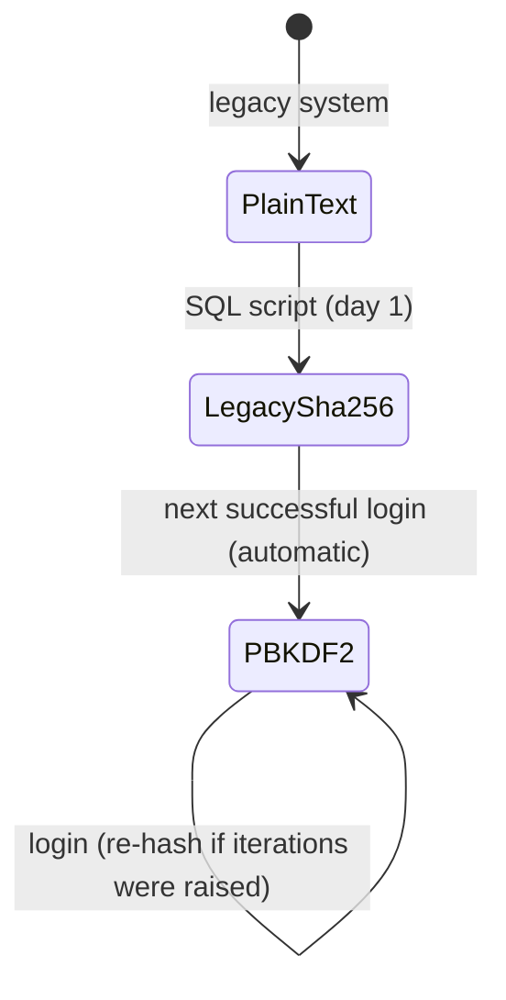

# Legacy Auth Migration (ASP.NET Core)

[](https://github.com/JohnDavidV/aspnet-legacy-auth-migration/actions/workflows/ci.yml)


**How to get rid of plain-text passwords in a running system without forcing thousands of users to reset them.**

Inherited applications often store passwords in plain text or as unsalted SHA-256. They often "protect" download links with a hash of `id + secret + date`, and have no protection against brute force. This repository is a small, fully tested reference implementation of the strategy I used to harden systems like that while they stayed in production:

1. **Day 1, in SQL:** convert every password in place to `legacy-sha256$<hash>`. No readable password is left in the database, and nobody notices.
2. **On each successful login:** the API verifies the legacy value and **transparently re-hashes it** with PBKDF2-SHA256 (600,000 iterations, random salt).
3. **Track progress** with a query. When the legacy count reaches zero, delete the compatibility code.

> This is written from scratch as a portfolio piece. It mirrors work I did on real legacy ASP.NET (VB.NET / WebForms) systems: moving secrets out of source code, rewriting classic ASP endpoints, and migrating supplier and employee portals to salted hashes.

## What's inside

| Component | Details |
|---|---|
| `PasswordHasher` | Versioned format (`pbkdf2-sha256$iter$salt$hash`). It accepts the legacy formats and reports `SuccessRehashNeeded`. Comparisons are constant-time, it **fails closed** on malformed values, and it also upgrades hashes when the work factor is raised. |
| `AuthService` | Login with transparent upgrade. Unknown users are verified against a dummy hash, so **timing does not reveal valid usernames**. It handles forced password changes and a NIST-style password policy (length over composition rules, a common-password blocklist, and no username inside the password). |
| `LoginThrottle` | Per-account lockout with exponential backoff (30 s → 60 s → … max 15 min). It returns `429` with `Retry-After`. |
| `SignedLinks` | Expiring, tamper-proof public links (e.g. *"send this certificate to your bank"*): **HMAC-SHA256** over a length-prefixed payload, bound to a purpose and an exact expiry. It replaces the classic `SHA256(id|secret|date)` pattern. |
| Cookie session | `__Host-` cookie, `HttpOnly`, `Secure`, `SameSite=Strict`, 30-min sliding expiration. It returns 401/403 instead of redirects, and a policy blocks sensitive endpoints until a forced password change is done. |
| `sql/01_remove_plaintext_passwords.sql` | Idempotent in-place conversion with a dry-run mode. It hashes the UTF-8 bytes so non-ASCII passwords match the API. |
| `sql/02_track_migration_progress.sql` | How many accounts are modern, legacy, or still plain text. |



## Try it

```bash
cd src/LegacyAuth.Api
dotnet run --urls http://localhost:5080
```

The demo store has one user of each kind: `ana` (already PBKDF2), `luis` (legacy SHA-256) and `maria` (plain text, must change her password).

```bash
# Luis logs in with his old password; his hash is silently upgraded to PBKDF2
curl -c jar -H 'Content-Type: application/json' -d '{"username":"luis","password":"luis-old-pass"}' localhost:5080/auth/login

# He creates a 24 h link to his certificate that anyone can open...
curl -b jar -X POST localhost:5080/certificates/link
# ...but changing the id, the expiry or one character of the signature returns 403.

# Six wrong passwords in a row -> 429 Too Many Requests, Retry-After: 30
```

## Tests

```bash
dotnet test     # 18 tests: hashing formats & upgrades, malformed input, link tampering/expiry,
                # lockout backoff, transparent upgrade, forced change + policy
```

## License

MIT
